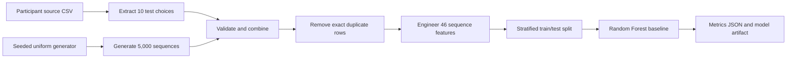

<div align="center">

# Human vs. Computer-Generated Sequences

**Can a short number sequence reveal how it was produced?**

An exploratory machine learning project comparing ten-number choices made by human participants with sequences from a seeded uniform random generator.


[Play the demo](#play-the-demo) · [Quick start](#quick-start) · [Results](#baseline-results) · [Pipeline](#pipeline) · [Limitations](#interpretation-and-limitations)

</div>

---

## Project at a glance

| | |
|---|---|
| **Task** | Binary classification of ten-number sequences |
| **Human sample** | 848 participant test-trial sequences |
| **Synthetic sample** | 5,000 independent uniform draws from 1–9 |
| **Features** | 46 summaries of frequency, runs, gaps, order, and local patterns |
| **Baseline** | Random Forest, stratified 80/20 held-out split |
| **Labels** | `0` computer · `1` human |

> **Important:** “Computer-generated” means one specific generator: ten independent uniform draws from 1 through 9. The reported results describe separation of this generator from the available human sample. They do not establish a general detector of computer-generated sequences.

## Play the demo

1. Open [the demo file](Demo/human-or-computer.html) on GitHub and click **Download raw file**. If you already have the repository locally, use `Demo/human-or-computer.html`.
2. Double-click the downloaded HTML file to open it in your browser. You can share this one file with a friend. It runs offline and needs no Python installation.
3. Think of **10 numbers from 1 to 9**. Repeats are allowed. Enter them as `3728416395`, `3 7 2 8 4 1 6 3 9 5`, or a comma-separated list, then click **Classify sequence**.

The demo displays the Random Forest's prediction and model scores for both classes. Click **Generate computer sequence** to fill the input with ten independent uniform draws, then classify it to compare. Individual predictions can be wrong.

### Rebuild the demo

After installing the dependencies in [Quick start](#quick-start), run these commands from the repository root:

```sh
python DataProcessing/pipeline.py
python Demo/build_demo.py
```

The first command creates `Models/random_forest.joblib`. The second exports its fitted trees and feature order into `Demo/human-or-computer.html`. Edit `Demo/human-or-computer.template.html` to change the interface or browser-side feature calculations, then rebuild the HTML.

## Quick start

Requires Python 3.10 or newer.

```powershell
git clone <repository-url>
cd HumanVsComputerGeneratedSequence
python -m venv .venv
.venv\Scripts\Activate.ps1
python -m pip install -r requirements.txt
python DataProcessing\pipeline.py
```

The pipeline reads `Data/human_data.csv` and rebuilds the derived data, trains the baseline model, and saves metrics. All paths are relative to the project, so it can run from any checkout location.

To change the random seed or number of generated sequences:

```powershell
python DataProcessing\pipeline.py --seed 42 --computer-count 5000
```

## Baseline results

The checked-in run used seed 42 and a stratified 80/20 split after removing three exact duplicate rows.

| Metric | Score |
|---|---:|
| Accuracy | **0.899** |
| Human precision | 0.683 |
| Human recall | 0.571 |
| Human F1 | **0.622** |
| ROC-AUC (Human positive) | **0.915** |

The test set contains 1,000 computer and 170 human sequences. Accuracy is affected by the class imbalance, so review the per-class scores and confusion matrix in `Reports/baseline_metrics.json` alongside it. These figures are a reproducible baseline, not evidence of broad real-world detection performance.

## Pipeline



Run the entire pipeline with `python DataProcessing/pipeline.py`. Its main steps can also be run independently from the project root:

1. `DataProcessing/extractData.py` extracts human test-trial sequences.
2. `DataProcessing/generateComputerSequences.py` generates seeded synthetic sequences.
3. `DataProcessing/combine_datasets.py` validates labels and values, combines, and shuffles the data.
4. `DataProcessing/pipeline.py` removes exact duplicates, engineers features, trains/evaluates the baseline, and saves artifacts.

### Generated artifacts

| Path | Contents |
|---|---|
| `Data/human_sequences.csv` | Ten choices and label `1` |
| `Data/computer_sequences.csv` | Generated choices and label `0` |
| `Data/combined_dataset.csv` | Shuffled union of the two classes |
| `Data/clean_combined_dataset.csv` | Modeling rows after exact deduplication |
| `Data/engineered_features.csv` | 46 features and the label |
| `Models/random_forest.joblib` | Fitted model plus feature and label metadata |
| `Reports/baseline_metrics.json` | Configuration, metrics, class report, and caveat |

Generated model and report artifacts are excluded from Git; run the pipeline to recreate them.

## Explore the notebooks

From the repository root:

```powershell
jupyter notebook
```

Suggested reading order:

1. `DataExploration/EDA.ipynb` — distributions and sequence patterns.
2. `DataValidation/Data_Validation_and_cleaning.ipynb` — schema and value checks.
3. `FeatureEngineering/FeatureEngineering.ipynb` — feature definitions and comparisons.
4. `Models/randomForest.ipynb` — model evaluation and feature importance.
5. `Models/XGBoost.ipynb` — optional XGBoost comparison (install `xgboost` separately).

The Python pipeline is the canonical way to reproduce the baseline artifacts. Notebooks are for interactive exploration.

## Data and label schema

Each sequence has ten integer values from 1 through 9 (`number_1` … `number_10`). The label convention is consistent across generated files and code:

| Label | Source |
|---:|---|
| `0` | Computer-generated |
| `1` | Human-generated |

`Data/human_data.csv` contains participant and questionnaire fields. The model pipeline reads only `number_choices_test_trials`; demographics, response latencies, and questionnaire answers are not model inputs.

## Interpretation and limitations

- The synthetic class is generated by a single uniform distribution. Other random generators can have different patterns and require separate evaluation.
- The human class is a finite sample. The split is sequence-level; participant identifiers are not carried into the extracted table, so participant-level holdout cannot currently be guaranteed.
- Exact duplicate rows are removed before splitting, which reduces direct duplicate leakage.
- The model is an exploratory baseline. A stronger study would compare multiple generators, retain participant IDs for group-aware splitting, report uncertainty across repeated splits, and evaluate on new human samples.

## Repository map

```text
Data/              Source data and generated sequence tables
DataProcessing/    Portable scripts and reproducible pipeline
DataExploration/   Exploratory data analysis notebook
DataValidation/    Data validation notebook
Demo/              Standalone browser demo, HTML template, and model exporter
FeatureEngineering/ Feature construction notebook
Models/            Model notebooks and generated model artifact
Reports/           Generated machine-readable evaluation report
```

## Citation, data use, and license

The repository does not currently include a source citation, data-use terms, or a license. Confirm the participant dataset’s citation and redistribution requirements and add an appropriate license before redistributing the data or reusing this project.
